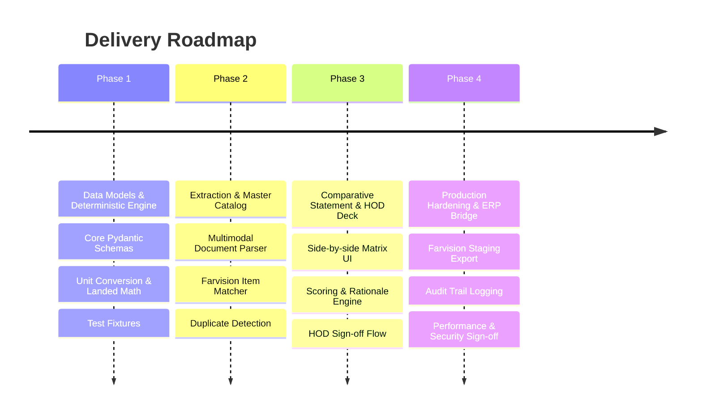

# Phase Roadmap: AI Procurement Copilot
**Project**: Vinayak Group AI Procurement Copilot  
**Repository**: [https://github.com/24f2007601/Vinayak_Procurement](https://github.com/24f2007601/Vinayak_Procurement)  
**Strategy**: Iterative Value Delivery (`/ponytail` principle: Ship core value loop first)

---

## Roadmap Overview

---

## Phase 1: Foundation, Schemas & Deterministic Math Engine
**Goal**: Build the indestructible mathematical and domain core. Zero hallucinations in calculations.

- **Milestone 1.1**: Define canonical Pydantic schemas:
  - `RequisitionRequest`, `FarvisionCatalogItem`
  - `RawVendorQuote`, `NormalizedQuote`
  - `ComparativeStatement`, `VendorScoringProfile`
- **Milestone 1.2**: Deterministic Cost Engine (`cost_engine.py`):
  - Standard UoM conversion matrix (sq.ft $\leftrightarrow$ sq.m, drum $\leftrightarrow$ litre, MT $\leftrightarrow$ kg).
  - Formulaic landed cost calculator with exact tax, freight, and discount resolution.
- **Milestone 1.3**: Test Suite:
  - Pytest unit tests for tax math, unit conversion, and edge cases (e.g. 0% GST, advance payment deductions).
- **Deliverable**: Tested core library that takes raw numbers and outputs 100% verified landed costs.

---

## Phase 2: Ingestion & Multimodal Extraction Pipeline
**Goal**: Transform messy unstructured inputs (WhatsApp notes, scanned PDFs) into validated schemas.

- **Milestone 2.1**: Requisition Parser:
  - Ingestion endpoint accepting raw text and audio transcripts.
  - Farvision item master fuzzy/semantic matcher.
  - Duplicate requisition warning engine.
- **Milestone 2.2**: Multimodal Quote Extraction:
  - Document ingestion supporting PDF, JPEG/PNG, and email copy.
  - Structured extraction using LLM function calling with strict fallback validation.
  - Extraction confidence scoring and field-level provenance linking (original quote snippet).
- **Milestone 2.3**: Vendor History Store:
  - Structured vendor profile repository recording past project quality, delivery times, and disputes.
- **Deliverable**: End-to-end API turning vendor quote files into normalized data objects.

---

## Phase 3: Comparative Statement Engine & HOD Approval Cockpit
**Goal**: Deliver the primary user experience where value is recognized by leadership.

- **Milestone 3.1**: Comparative Matrix Generator:
  - Side-by-side comparison across all responding vendors.
  - Highlighted commercial risks (missing scope, unverified tax components, extra freight liabilities).
- **Milestone 3.2**: Recommendation & Rationale Engine:
  - Algorithmic vendor ranking ($60\%$ Price, $25\%$ Delivery, $15\%$ Quality).
  - Plain-English rationale generator summarizing trade-offs for executive audit defense.
- **Milestone 3.3**: Executive Cockpit (UI):
  - Requisition dashboard for project sites.
  - Comparative Statement grid with source-quote inspection modals.
  - 1-Click HOD approval card with digital audit stamp.
- **Deliverable**: Interactive operational web dashboard ready for user testing.

---

## Phase 4: Production Hardening, ERP Bridge & Deployment
**Goal**: Secure, audit-ready operational deployment for Vinayak Group's active projects.

- **Milestone 4.1**: Farvision ERP Integration Bridge:
  - Clean CSV/JSON export matching Farvision's exact PO schema.
  - Webhook dispatcher for downstream ERP staging tables.
- **Milestone 4.2**: Security & Access Controls:
  - Role-based permissions (Site Engineer vs. Procurement Officer vs. HOD).
  - Immutable audit logs tracking who approved what quote and why.
- **Milestone 4.3**: Containerization & Deployment:
  - Multi-stage Dockerfile and lightweight local/cloud hosting deployment.
  - Health check and monitoring endpoints (`/health`, `/ready`).
- **Deliverable**: Production-ready containerized service with documentation and user guide.
