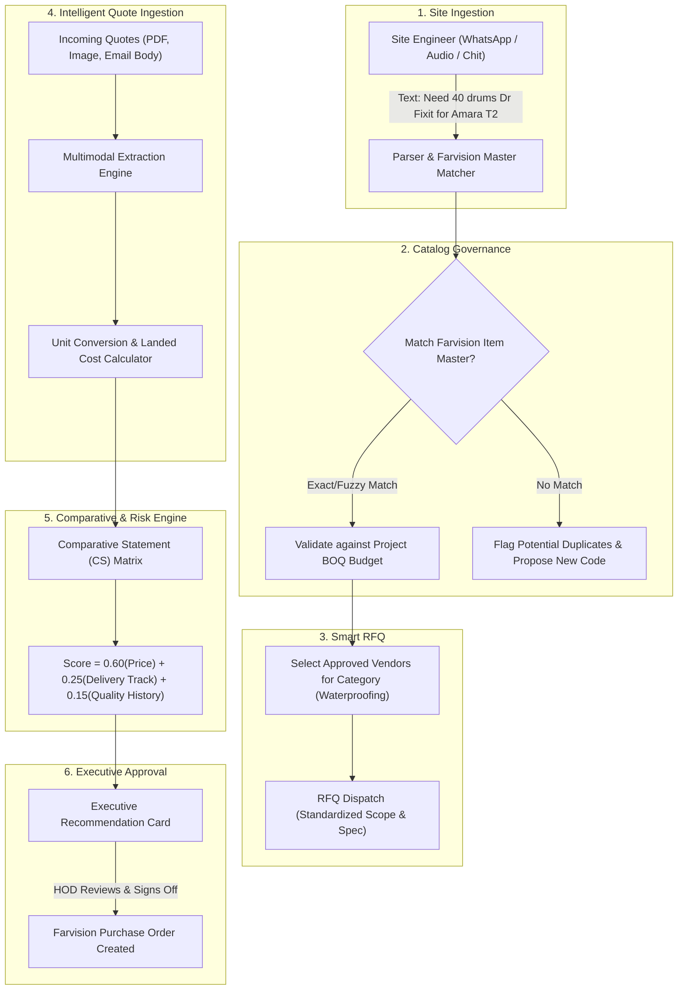

# Product Plan: AI Procurement Copilot (Vinayak Group)
**Document Type**: Senior AI Product Manager & Builder Execution Plan  
**Repository**: [https://github.com/24f2007601/Vinayak_Procurement](https://github.com/24f2007601/Vinayak_Procurement)  
**Target Domain**: Mid-Market Indian Residential Real Estate (Vinayak Group, Kolkata)  
**Reference Project**: Waterproofing Package — Vinayak Amara, Tower-2  
**Philosophy**: `/ponytail` (High leverage, zero unnecessary code, deterministic math, human-in-the-loop)

---

## 1. Executive Summary & Problem Reality

### 1.1 The Real Construction Bottleneck
Vinayak Group currently operates five active residential projects across Kolkata. Every material requirement and sub-contract work package traverses an inefficient, high-friction manual chain:
- **Site Requisitions**: Arrive via fragmented channels (WhatsApp text, voice notes, paper chits). Site engineers avoid ERP interfaces because of complexity and latency.
- **Farvision ERP Disconnect**: Back-office staff manually re-key descriptions into Farvision, leading to duplicate item codes, incorrect inventory classification, and rogue purchasing.
- **Quote Asymmetry**: Vendor quotations arrive in unstructured formats (scanned PDFs, WhatsApp images, email text) with disparate terms:
  - Inconsistent Units of Measure (UoM) (e.g., per sq.ft vs. per sq.m vs. per 20-litre drum).
  - Unclear Tax Structures (GST 18% vs. 28%, RCM liabilities).
  - Hidden Freight/Handling Terms (Ex-factory vs. F.O.R. site delivery).
  - Omitted Scope (e.g., quote excludes surface preparation, scaffolding, or primer coat).
- **Tribal Knowledge & L1 Trap**: The lowest quoted vendor (L1) on paper is often selected despite a history of site delays, material adulteration, or legal disputes. This track record remains trapped in senior leadership's memory and is not codified.
- **Audit Vulnerability**: Deviating from L1 to select a better vendor (L2) currently lacks an auditable, recorded rationale, exposing the procurement team to kickback suspicions and audit issues.

---

## 2. Product Architecture & Technical Tenets



### 2.1 The Four Non-Negotiable Tenets
1. **Deterministic Arithmetic, Probabilistic Extraction**:
   - LLMs handle parameter extraction (base rates, tax percentages, payment days, exclusions).
   - **Zero LLM calculation**: Landed cost calculations, unit rate conversions, and scoring are executed via deterministic code.
2. **AI Recommends, Human Sanctions (Zero Autonomous Spend)**:
   - The system produces an audit-ready Comparative Statement and explicit recommendation rationale.
   - The Head of Department (HOD) or Project Director holds final sign-off authority.
3. **Traceability to Source (Click-to-Verify)**:
   - Every line item rate in the Comparative Statement links back to the vendor's source document.
4. **Quantified Vendor Reliability**:
   - Past vendor performance (on-time delivery, material test rejections, dispute records) directly weights the final score.

---

## 3. Core Functional Modules

### Module 1: Requisition Parser & Catalog Matcher
- **Inputs**: Raw text, voice transcription, or structured web form.
- **Processing**:
  - Extracts metadata: Project (`Vinayak Amara`), Tower (`Tower-2`), Sub-trade (`Waterproofing`), Material Name, Quantity, Required By Date.
  - Matches against the Farvision Item Master using semantic and token-based similarity.
  - Verifies quantity against the baseline Bill of Quantities (BOQ).
  - Duplicate detection: Identifies prior orders within an active window to prevent over-stocking.

### Module 2: Multimodal Quote Extraction & Normalization
- **Inputs**: Vendor quotations (PDF, JPEG/PNG images, plain text emails).
- **Extracted Fields**:
  - Base Unit Rate & Quoted Unit (e.g., ₹/sq.ft, ₹/drum).
  - Applicable GST Rate (18%, 28%, or Nil/RCM).
  - Freight & Unloading charges (Included, Extra at actuals, or Fixed).
  - Payment Terms (Advance %, Credit Days, PDC requirements).
  - Delivery Lead Time (Days).
  - Exclusions & Deviations (e.g., surface preparation excluded, scaffolding not included).
- **Normalization Formula**:
  $$\text{Landed Cost} = (\text{Normalized Qty} \times \text{Base Rate}) + \text{Freight} + \text{Taxes} - \text{Early Payment Discounts}$$
  $$\text{Normalized Unit Rate} = \frac{\text{Landed Cost}}{\text{Standard BOQ Quantity}}$$

### Module 3: Comparative Statement (CS) Matrix
- Generates an apples-to-apples side-by-side comparison matrix.
- Surfaces hidden commercial discrepancies:
  - Disparities in freight and transit insurance.
  - Excluded sub-items required for complete execution.
  - Cost variance compared to the original engineering estimate.

### Module 4: Vendor Risk & Scoring Engine
- **Composite Scoring Formula**:
  $$\text{Score} = w_{\text{price}} \cdot \left(\frac{\text{Landed Cost}_{\text{L1}}}{\text{Landed Cost}_i}\right) + w_{\text{delivery}} \cdot (\text{On-Time Delivery \%}) + w_{\text{quality}} \cdot (\text{Quality Pass Rate}) - \text{Dispute Penalty}$$
  - Default Weights: $w_{\text{price}} = 0.60$, $w_{\text{delivery}} = 0.25$, $w_{\text{quality}} = 0.15$.
  - Generates clear plain-text explanations when recommending a higher-priced vendor over an unreliable L1 vendor.

### Module 5: HOD Executive Decision Deck
- High-density executive summary card.
- Displays:
  - Top Recommendation with transparent justification.
  - Total Budget Savings vs. Baseline BOQ.
  - Key Commercial Risks & Vendor Red Flags.
  - One-click approval button that generates an exportable Farvision-compatible PO payload.

---

## 4. The Ponytail Elimination Ledger

| Feature / Capability | Enterprise Bloat (Skipped) | Ponytail Lean Approach (Built) |
|---|---|---|
| **Mobile Access** | Custom native iOS & Android applications | Responsive Web Application (PWA ready) |
| **Document Processing** | Complex OCR training pipelines (Tesseract/PaddleOCR) | Multimodal LLM with strict Pydantic JSON schema |
| **Financial Calculations** | LLM-generated math / unstructured narratives | Deterministic Python calculation engine |
| **ERP Integration** | Heavy two-way live database sync | Structured CSV/JSON staging export format |
| **Vendor Messaging** | Live external email dispatches to actual vendors | Test inbox routing / staging simulator |
| **Data Persistence** | Multi-node distributed database clusters | Clean local SQLite / PostgreSQL relational models |

---

## 5. Data Models & Schemas

### 5.1 Requisition
```json
{
  "requisition_id": "REQ-AMR-T2-001",
  "project": "Vinayak Amara",
  "tower": "Tower-2",
  "category": "Waterproofing",
  "item_name": "Elastomeric Waterproofing Coating",
  "specification": "Two-component polymer-modified cementitious coating",
  "boq_quantity": 12500,
  "boq_unit": "sq.ft",
  "budget_rate": 45.0,
  "required_by": "2026-12-15"
}
```

### 5.2 Vendor Quote (Normalized)
```json
{
  "quote_id": "QTE-2026-089",
  "vendor_id": "VEND-KOL-042",
  "vendor_name": "Bengal Waterproofing Solutions",
  "quoted_rate": 39.5,
  "quoted_unit": "sq.ft",
  "gst_percent": 18.0,
  "freight_terms": "FOR Site (Included)",
  "freight_amount": 0.0,
  "payment_terms_days": 30,
  "lead_time_days": 5,
  "exclusions": ["Surface grinding and crack filling"],
  "landed_unit_rate": 46.61,
  "total_landed_cost": 582625.0
}
```

### 5.3 Comparative Output
```json
{
  "comparative_id": "CS-AMR-T2-WP",
  "package": "Waterproofing at Vinayak Amara, Tower-2",
  "vendors_evaluated": 3,
  "l1_vendor": "Bengal Waterproofing Solutions",
  "recommended_vendor": "Dulux Aquatech Pro Contractors",
  "recommendation_reason": "While Bengal Waterproofing is L1 by 2.8%, they excluded surface grinding (estimated at ₹35,000 extra) and have 2 active delay disputes at Vinayak Vista. Dulux is all-inclusive with 98% on-time record.",
  "status": "AWAITING_HOD_APPROVAL"
}
```

---

## 6. Implementation Milestones

### Phase 1: Foundation & Data Normalizer (Day 1)
- Setup project workspace with clean feature-based layout.
- Implement Pydantic data models for Requisitions, Vendor Quotes, and Comparative Statements.
- Implement deterministic math engine for landed cost and vendor scoring.
- Add unit tests for conversions (sq.ft to sq.m, drum volume, GST addition).

### Phase 2: Ingestion & Extraction Engine (Day 2)
- Build multimodal quote extractor supporting PDFs, images, and text formats.
- Integrate catalog matching service for Farvision item resolution.
- Implement vendor track record store with realistic mock history for Vinayak's vendor panel.

### Phase 3: Comparative Statement & Recommendation Deck (Day 3)
- Build the Comparative Statement generation pipeline.
- Implement recommendation engine generating human-readable audit rationale.
- Create web interface:
  - Requisition view.
  - Multi-quote comparison grid.
  - HOD approval summary card.

### Phase 4: Verification & Handoff (Day 4)
- Run end-to-end simulation on the Vinayak Amara Tower-2 Waterproofing package.
- Verify that financial calculations are exact to the paisa.
- Validate Farvision ERP export file structure.
