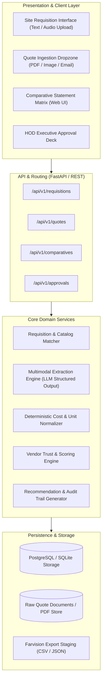

# System Architecture: AI Procurement Copilot
**Project**: Vinayak Group AI Procurement Copilot  
**Repository**: [https://github.com/24f2007601/Vinayak_Procurement](https://github.com/24f2007601/Vinayak_Procurement)  
**Author**: Senior AI PM / Principal Architect  
**Methodology**: `/ponytail` (Minimal moving parts, deterministic finance, clean boundaries)

---

## 1. High-Level Architecture Overview

The system bridges unstructured field reality (WhatsApp, PDF quotes, handwritten slips) with strict back-office governance (Farvision ERP and HOD approvals).



---

## 2. Component Breakdown

### 2.1 Presentation Layer
- **Requisition View**: Mobile-responsive quick entry for site engineers (voice note upload or plain text paste).
- **Quote Uploader**: Multi-file dropzone accepting PDFs, scanned bills, and raw email text.
- **Comparative Statement (CS) Grid**: Interactive matrix with side-by-side rates, line-item adjustments, and click-to-source citations.
- **HOD Executive Card**: Clean decision cockpit displaying L1 vs Recommended Vendor, cost variance, risk highlights, and the "Sign & Approve" button.

### 2.2 Domain Services & Trust Boundaries

```
[Untrusted Client Input]
          │
          ▼
┌─────────────────────────────────┐
│ Input Validation (Pydantic)     │ <--- Strict type & size boundary
└─────────────────────────────────┘
          │
          ▼
┌─────────────────────────────────┐
│ Multimodal LLM Extraction       │ <--- Probabilistic extraction only
│ (Gemini / Claude / OpenAI)      │      (Rates, Units, Taxes, Exclusions)
└─────────────────────────────────┘
          │
          ▼
┌─────────────────────────────────┐
│ Deterministic Normalizer        │ <--- ZERO LLM MATH
│ (Python Pure Functions)         │      Landed Cost = (Qty * Rate) + Tax + Freight
└─────────────────────────────────┘
          │
          ▼
┌─────────────────────────────────┐
│ Vendor Scoring Engine           │ <--- Weighted formula (Cost + Reliability)
└─────────────────────────────────┘
          │
          ▼
┌─────────────────────────────────┐
│ Executive Approval Gate         │ <--- Mandatory human sanction
└─────────────────────────────────┘
```

#### A. Requisition & Catalog Matcher (`catalog_service.py`)
- Takes raw descriptions (e.g. *"Dr Fixit 40 drums for Amara T2"*).
- Uses token match + semantic embedding lookup against the Farvision Item Master catalog.
- Checks pending purchase orders for duplicate requisition detection.

#### B. Multimodal Extraction Engine (`extractor_service.py`)
- Ingests PDFs, images, or raw email text.
- Enforces strict Pydantic JSON schemas.
- Rejects unparseable documents early with actionable error messages.
- Returns bounding boxes/text excerpts for auditable verification.

#### C. Deterministic Cost Normalizer (`cost_engine.py`)
- **Unit Conversion**: Canonicalizes all units to project BOQ standards (e.g., Sq.ft $\rightarrow$ Sq.m, Drums $\rightarrow$ Litres).
- **Landed Rate Computation**:
  $$\text{Base Cost} = \text{Normalized Quantity} \times \text{Quoted Rate}$$
  $$\text{Taxes} = \text{Base Cost} \times \frac{\text{GST \%}}{100}$$
  $$\text{Landed Total} = \text{Base Cost} + \text{Taxes} + \text{Freight} - \text{Discounts}$$
  $$\text{Effective Unit Rate} = \frac{\text{Landed Total}}{\text{BOQ Standard Quantity}}$$

#### D. Vendor Scoring Engine (`scoring_service.py`)
- Blends price competitiveness with vendor track record:
  $$\text{Score} = 0.60 \times \left(\frac{\text{Landed Cost}_{\text{L1}}}{\text{Landed Cost}_i}\right) + 0.25 \times \text{On-Time Delivery \%} + 0.15 \times \text{Quality Pass \%} - \text{Dispute Penalty}$$

---

## 3. Storage & Data Models

### Relational Schema (SQLite / PostgreSQL)
1. `projects`: `id`, `name` (Vinayak Amara), `location` (Rajarhat), `active_towers`.
2. `item_catalog`: `item_code` (Farvision ID), `canonical_name`, `category`, `standard_uom`, `budget_rate`.
3. `requisitions`: `id`, `project_id`, `item_code`, `boq_qty`, `requested_qty`, `status`.
4. `vendors`: `id`, `name`, `category`, `on_time_pct`, `quality_pass_pct`, `dispute_count`, `active_flag`.
5. `quotes`: `id`, `requisition_id`, `vendor_id`, `raw_file_url`, `quoted_rate`, `quoted_uom`, `gst_pct`, `freight_amount`, `payment_terms`, `exclusions_json`, `landed_cost`.
6. `comparative_statements`: `id`, `requisition_id`, `l1_vendor_id`, `recommended_vendor_id`, `recommendation_reason`, `hod_approval_status`, `approved_by`, `approved_at`.

---

## 4. Hardware & Deployment Topology (Ponytail Clean)

- **Compute**: Single containerized service (FastAPI + Static React Frontend) or lightweight Docker Compose.
- **Memory/CPU**: 1 vCPU, 2GB RAM sufficient for all API routing, PDF processing, and deterministic math.
- **LLM Call Protocol**: Async streaming with backoff retry and circuit breaker on rate limits.
- **ERP Integration**: File-based staging export (CSV / Farvision-ready JSON format) to decouple from proprietary ERP networking limitations.
